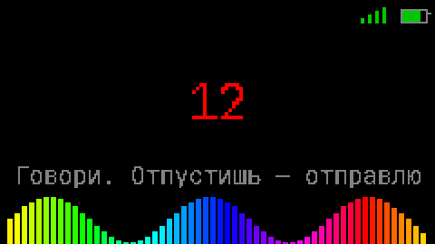
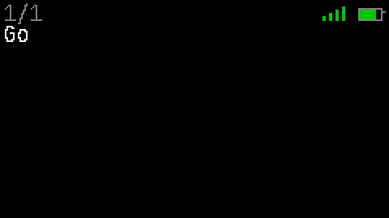

# AIstickC

**Карманный голосовой ассистент в корпусе M5StickC PLUS2.** Зажал кнопку —
сказал — получил ответ на экране. Распознавание речи, ответ LLM, кириллица
собственным шрифтом, память диалога и энергосбережение. Всё на одной плате
размером с брелок.

[](https://github.com/elcrazycol/AIstickC/actions/workflows/tests.yml)
[](https://platformio.org/)
[](LICENSE)



---

## Что это

Устройство, которое делает ровно одну вещь: **вопрос голосом → ответ
текстом**. Без облачных приложений, подписок и телефона рядом — только стик,
Wi-Fi и два API.

Что внутри необычного:

- **Свой прокси на VPS.** `api.groq.com` недоступен из России напрямую (403,
  гео-блок), поэтому распознавание идёт через свой сервер: стик отдаёт сырой
  PCM, прокси собирает multipart и ходит в Whisper. Ключ Groq живёт на сервере
  и в прошивку не попадает вообще.
- **Ответ появляется по мере генерации.** Запрос к модели идёт потоком (SSE),
  текст печатается на экране, а не вываливается целиком через пять секунд.
- **Память диалога.** Помнит последние 5 обменов и подставляет их в контекст.
- **Своя кириллица.** Встроенные шрифты M5GFX кириллицу не умеют, поэтому
  шрифт генерируется скриптом из JetBrains Mono.
- **Размышления модели отключены.** Иначе все модели OpenCode Go кладут ответ
  в `reasoning_content`, а `content` приходит пустым или в самом конце — и
  ответ занимает вдвое больше времени.

## Демо

| Запись | Ожидание | Ответ печатается |
|---|---|---|
|  |  |  |

Все картинки — из `tools/mock_screen.py`, который рисует экраны тем же
сгенерированным шрифтом и картинкой, что идут в прошивку. Камера не нужна.

Статичные экраны: [главный](docs/images/screen-idle.png),
[запись](docs/images/screen-recording.png),
[ожидание](docs/images/screen-waiting.png),
[ответ](docs/images/screen-answer.png),
[панель сброса](docs/images/screen-notice.png).

## Железо

| Параметр | Значение |
|---|---|
| Плата | M5StickC PLUS2 |
| Чип | ESP32-PICO-V3-02 (классический ESP32, 2 ядра 240 МГц) |
| Память | 8 МБ flash, 2 МБ PSRAM |
| Микрофон | SPM1423, **PDM** (не I2S) |
| Пины микрофона | данные G34, PDM-клок G0 |
| Экран | 240×135 ST7789v2 |
| Кнопки | BtnA (передняя), BtnB (боковая), PWR (верхняя) |
| Звук | пьезо-бузер на PWM, GPIO2 |
| Питание | встроенный аккумулятор, зарядка по USB-C |

Три вещи, которые выяснились на живой плате и определили код:

1. **DMA на классическом ESP32 не пишет в PSRAM.** Захват идёт кусками по 8 КБ
   в DRAM, оттуда `memcpy` в PSRAM. Без этого — белый шум.
2. **PSRAM включается вручную.** Ядро `arduino-esp32` выкидывает `CONFIG_SPIRAM`
   и не зовёт `psramInit()`, если при сборке не определён `BOARD_HAS_PSRAM`.
3. **PDM-микрофону нужен прогрев.** Первые ~200 мс — DC-ступенька, а не звук.
   Захватываем и выбрасываем, иначе в начало записи попадает щелчок.

## Архитектура

```
        запись (PCM)                       текст
стик ────────────────> VPS-прокси ────────────────> Groq Whisper
 │  HTTPS :9443              │  ключ Groq здесь
 │                           └─ multipart + WAV собирает сервер
 │
 │  HTTPS, stream:true
 └────────────────────> opencode.ai/zen/go/v1 ─────> DeepSeek
        JSON, SSE-поток        (x-opencode-session)
```

Почему так, а не напрямую: `opencode.ai` из России доступен, поэтому LLM идёт
напрямую; `api.groq.com` — нет, поэтому только распознавание через прокси.

### Структура репозитория

```
aistick/
├─ src/
│  ├─ main.cpp            диспетчер состояний, кнопки, энергосбережение
│  ├─ ui.cpp/.h           всё рисование: экраны, шрифт, анимации
│  ├─ net.cpp/.h          Wi-Fi и общий TLS-клиент
│  ├─ stt.cpp/.h          запрос к прокси → Whisper
│  ├─ llm.cpp/.h          запрос к OpenCode Go потоком (SSE)
│  └─ pure/               чистые модули: без Arduino, тестируются на Mac
│     ├─ chat_history.h   память диалога с обрезкой
│     ├─ chunked.h        инкрементальный декодер chunked
│     ├─ http_response.h  разбор HTTP-ответа
│     ├─ json_extract.h   вытаскивание полей по пути
│     ├─ llm_request.h    сборка JSON-запроса
│     ├─ sse.h            разбор Server-Sent Events
│     ├─ text_wrap.h      перенос UTF-8 по пикселям + пагинация
│     ├─ wav.h            WAV-заголовок
│     ├─ base64.h, cyrillic.h
├─ include/
│  ├─ settings.h          не-секретные настройки
│  ├─ config.h.example    шаблон секретов (config.h в .gitignore)
│  ├─ font_jbmono.h       сгенерированный шрифт с кириллицей
│  └─ idle_image.h        сгенерированная картинка главного экрана
├─ tools/
│  ├─ run_tests.sh        прогон тестов (clang++, без железа)
│  ├─ capture.py          serial → WAV / лог устройства
│  ├─ make_font.py        TTF → GFXfont
│  ├─ make_image.py       PNG → RGB565/1-бит
│  └─ mock_screen.py      эмулятор экрана → PNG/GIF для README
├─ deploy/                прокси на VPS (см. deploy/README.md)
└─ test/                  нативные тесты
```

Ключевая идея — `src/pure/`: там живёт вся логика, которую можно проверить без
железа и без PlatformIO (разбор JSON, SSE, chunked, перенос текста, история).
Прошивка только склеивает эти модули с сетью и экраном.

## Быстрый старт

```bash
# 1. Инструменты
uv tool install platformio

# 2. Секреты
cp include/config.h.example include/config.h
# заполни WIFI_SSID, WIFI_PASS (сеть 2.4 ГГц — ESP32 не видит 5 ГГц)

# 3. Прокси на VPS (нужен для распознавания)
#    пошагово: deploy/README.md
bash deploy/push.sh <твой-домен> 9443
bash deploy/fill-config.sh <твой-домен> 9443   # пропишет PROXY_* в config.h

# 4. Прошивка
pio run -e esp32dev -t upload

# 5. Лог устройства (сам открывает порт и перезагружает плату)
python3 tools/capture.py --monitor
```

## Управление

| Действие | Что делает |
|---|---|
| **BtnA** (зажать) | запись; отпустил — отправил |
| **BtnB** (тап) | предыдущая страница |
| **PWR** (тап, верхняя) | следующая страница |
| **BtnB** (зажать 3 с) | сброс сессии: полоска → панель «История разговора очищена» → главный экран |

Пока держишь BtnB — внизу растёт полоска удержания; панель сброса висит до
отпускания, чтобы её нельзя было пропустить.

## Как устроено

**Распознавание.** Стик шлёт сырой LPCM (16 бит, LE, моно, 16 кГц) на свой
прокси. Прокси собирает WAV и multipart и ходит в `whisper-large-v3-turbo`.
Прошивка от этого проще: ни WAV-заголовка, ни multipart на устройстве.

**Ответ.** `POST /zen/go/v1/chat/completions` со `stream:true` и
`reasoning_effort:"none"`. Ответ приходит как `text/event-stream`; куски
`delta.content` печатаются на экране сразу. Chunked-тело декодируется
инкрементально, поэтому память не растёт с длиной потока.

**Память.** Последние 5 обменов хранятся в куче и уходят в запрос как массив
`messages`. Обрезка — по числу обменов и по бюджету символов, чтобы запрос не
раздувался. Счётчик отправленных сообщений живёт в NVS и переживает выключение.

**Экран.** Собственный моноширинный шрифт (ASCII + кириллица + типографика:
тире, кавычки, многоточие). Текст переносится по словам и разбивается на
страницы. Пока идёт работа — три перетекающие точки, которые анимирует
отдельная задача на втором ядре (сетевые вызовы блокирующие, из основного цикла
анимация замирала на TLS-рукопожатии).

## Тесты

```bash
tools/run_tests.sh
```

Компилируются `clang++` и не требуют ни PlatformIO, ни железа — то есть
прогоняются где угодно. Сейчас **10 наборов**: `chat_history`, `chunked`,
`http_response`, `json`, `llm_request`, `sse`, `text_wrap`, `wav`, `base64`,
`cyrillic`. Тот же прогон крутится в CI на каждый push (бейдж в шапке).

## Энергопотребление

Простой экономится ступенями (пороги в `include/settings.h`):

| Через | Что происходит |
|---|---|
| 20 с | гаснет подсветка (возвращается мгновенно по любой кнопке) |
| 90 с | выключается Wi-Fi (следующий вопрос поднимает его сам) |
| 1 час | глубокий сон; будит большая кнопка |

Глубокий сон, а не просто простой: он экономит больше всего, но при
пробуждении Wi-Fi поднимается заново — поэтому порог в час, когда активная
сессия уже точно закончилась.

## Почему так (отклонения от исходного ТЗ)

Проект начинался как ТЗ на ESP32-S3 с I2S-микрофоном. Реальное железо и
реальные API внесли правки:

| В ТЗ | В жизни | Почему |
|---|---|---|
| ESP32-S3 | ESP32-PICO-V3-02 | такая плата на руках |
| Микрофон I2S SPM1429 | PDM SPM1423 | тот же корпус, другой интерфейс |
| Groq напрямую | через свой прокси | гео-блок 403 из России |
| Запись 8 с | 15 с | пользователю мало |
| Ответ целиком | стриминг SSE | чтобы текст появлялся сразу |
| Шрифт 16 px, 7 строк | 14 px, 5 строк | плотные метрики шрифта |
| «Размышления» модели | `reasoning_effort:"none"` | иначе пустой ответ и вдвое дольше |

## Дорожная карта

**Сделано:** милестоуны 0–2 (железо, распознавание, ответ), UI со своим
шрифтом, память диалога, стриминг, картинка и батарея на главном,
энергосбережение.

**Осталось:**

- RTC-журнал: сохранять последние этапы и ошибки в RTC-память, чтобы причина
  сброса переживала перезагрузку (сейчас «молча перезагрузилось» ловится вслепую).
- Отдельное сообщение «Не расслышал» для пустого распознавания.
- Автовозврат в IDLE через 5 с после ошибки.
- Отмена записи кнопкой.

**Не проверено вживую:** пробуждение из глубокого сна и запись максимальной
длины (15 с) — оба прогонялись только в меньших масштабах.

## Благодарности

- **JetBrains Mono** — шрифт, лицензия OFL 1.1; глифы собираются в GFXfont.
- **M5Unified / M5GFX** — работа с платой и экраном.
- **Konata** — картинка на главном экране (личное украшение, не под MIT).

## Лицензия

[MIT](LICENSE). Исключения: шрифт — OFL 1.1, картинка персонажа — не под MIT.
