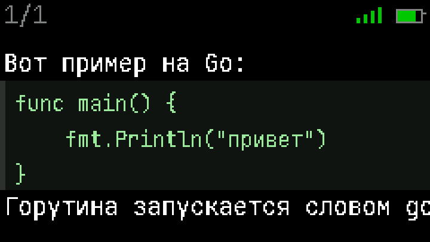

# AIstickC

**Карманный голосовой ассистент в корпусе M5StickC PLUS2.** Зажал кнопку —
сказал — получил ответ на экране. Распознавание речи, ответ LLM, кириллица
собственным шрифтом, память диалога и энергосбережение. Всё на одной плате
размером с брелок.

[](https://github.com/elcrazycol/AIstickC/releases/latest)
[](https://github.com/elcrazycol/AIstickC/actions/workflows/tests.yml)
[](https://platformio.org/)
[](LICENSE)


---

## Что это

Устройство, которое делает ровно одну вещь: **вопрос голосом → ответ
текстом**. Без облачных приложений, подписок и телефона рядом — только стик,
Wi-Fi и два API.

Что внутри необычного:

- **Свой прокси на VPS.** `api.groq.com` недоступен из России напрямую (403,
  гео-блок), поэтому распознавание идёт через свой сервер: стик отдаёт сырой
  PCM, прокси собирает multipart и ходит в Whisper. Ключ Groq живёт на сервере
  и в прошивку не попадает вообще.
- **Ответ появляется по мере генерации.** Запрос к модели идёт потоком (SSE),
  текст печатается на экране, а не вываливается целиком через пять секунд.
- **Память диалога.** Помнит последние 5 обменов и подставляет их в контекст.
- **Своя кириллица.** Встроенные шрифты M5GFX кириллицу не умеют, поэтому
  шрифт генерируется скриптом из JetBrains Mono.
- **Размышления модели отключены.** Иначе все модели OpenCode Go кладут ответ
  в `reasoning_content`, а `content` приходит пустым или в самом конце — и
  ответ занимает вдвое больше времени.

## Демо

| Запись | Ожидание | Ответ печатается |
|---|---|---|
|  |  |  |

Статичные экраны: [главный](docs/images/screen-idle.png),
[запись](docs/images/screen-recording.png),
[ожидание](docs/images/screen-waiting.png),
[ответ](docs/images/screen-answer.png),
[панель сброса](docs/images/screen-notice.png),
[панель плагинов](docs/images/screen-plugins.png),
[настройки](docs/images/screen-settings.png),
[вызов инструмента](docs/images/screen-tool.png),
[диалог и ответ](docs/images/screen-dialog.png),
[питание](docs/images/screen-power.png),
[кнопки](docs/images/screen-buttons.png),
[код](docs/images/screen-code.png).

## Железо

| Параметр | Значение |
|---|---|
| Плата | M5StickC PLUS2 |
| Чип | ESP32-PICO-V3-02 (классический ESP32, 2 ядра 240 МГц) |
| Память | 8 МБ flash, 2 МБ PSRAM |
| Микрофон | SPM1423, **PDM** (не I2S) |
| Пины микрофона | данные G34, PDM-клок G0 |
| Экран | 240×135 ST7789v2 |
| Кнопки | BtnA (передняя), BtnB (боковая), PWR (верхняя) |
| Звук | пьезо-бузер на PWM, GPIO2 |
| Питание | встроенный аккумулятор, зарядка по USB-C |

Три вещи, которые выяснились на живой плате и определили код:

1. **DMA на классическом ESP32 не пишет в PSRAM.** Захват идёт кусками по 8 КБ
   в DRAM, оттуда `memcpy` в PSRAM. Без этого — белый шум.
2. **PSRAM включается вручную.** Ядро `arduino-esp32` выкидывает `CONFIG_SPIRAM`
   и не зовёт `psramInit()`, если при сборке не определён `BOARD_HAS_PSRAM`.
3. **PDM-микрофону нужен прогрев.** Первые ~200 мс — DC-ступенька, а не звук.
   Захватываем и выбрасываем, иначе в начало записи попадает щелчок.

## Архитектура

```
        запись (PCM)                       текст
стик ────────────────> VPS-прокси ────────────────> Groq Whisper
 │  HTTPS :9443              │  ключ Groq здесь
 │                           └─ multipart + WAV собирает сервер
 │
 │  HTTPS, stream:true
 └────────────────────> opencode.ai/zen/go/v1 ─────> DeepSeek
        JSON, SSE-поток        (x-opencode-session)
```

Почему так, а не напрямую: `opencode.ai` из России доступен, поэтому LLM идёт
напрямую; `api.groq.com` — нет, поэтому только распознавание через прокси.

### Структура репозитория

```
aistick/
├─ src/
│  ├─ main.cpp            диспетчер состояний, кнопки, энергосбережение
│  ├─ ui.cpp/.h           всё рисование: экраны, шрифт, анимации
│  ├─ net.cpp/.h          Wi-Fi и общий TLS-клиент
│  ├─ stt.cpp/.h          запрос к прокси → Whisper
│  ├─ llm.cpp/.h          запрос к OpenCode Go потоком (SSE)
│  ├─ plugins.cpp/.h      плагины: загрузка скриптов и запуск
│  ├─ script_host.cpp/.h  белый список функций для скриптов
│  ├─ repo.cpp/.h         репозитории: манифесты, установка, версии
│  ├─ webfetch.cpp/.h     https-запросы (общие для плагинов и репозиториев)
│  ├─ hold.cpp/.h         удержание кнопки: отсчёт и полоска снизу
│  ├─ chat_settings.cpp/.h  выбор памяти и лимита ответа (хранится в NVS)
│  └─ pure/               чистые модули: без Arduino, тестируются на Mac
│     ├─ chat_history.h   память диалога с обрезкой
│     ├─ chunked.h        инкрементальный декодер chunked
│     ├─ chat_options.h   ступени настроек и подбор «авто»
│     ├─ hold_button.h    отсчёт удержания кнопки (события и проценты)
│     ├─ http_response.h  разбор HTTP-ответа
│     ├─ json_extract.h   вытаскивание полей по пути
│     ├─ llm_request.h    сборка JSON-запроса
│     ├─ plugin_meta.h    шапка скрипта → описание инструмента
│     ├─ plugin_repo.h    разбор манифеста репозитория
│     ├─ script.h         интерпретатор языка плагинов
│     ├─ sse.h            разбор Server-Sent Events
│     ├─ text_wrap.h      перенос UTF-8 по пикселям + пагинация
│     ├─ tool_call.h      инструменты для модели и разбор её вызова
│     ├─ wav.h            WAV-заголовок
│     ├─ weather_text.h   сборка русского текста погоды
│     ├─ base64.h, cyrillic.h
├─ include/
│  ├─ settings.h          не-секретные настройки
│  ├─ config.h.example    шаблон секретов (config.h в .gitignore)
│  ├─ font_jbmono.h       сгенерированный шрифт с кириллицей
│  └─ idle_image.h        сгенерированная картинка главного экрана
├─ data/
│  └─ plugins/*.ais       плагины (заливаются в LittleFS)
├─ partitions.csv         таблица разделов: 3 МБ прошивке, 4 МБ LittleFS
├─ tools/
│  ├─ run_tests.sh        прогон тестов (clang++, без железа)
│  ├─ capture.py          serial → WAV / лог устройства
│  ├─ make_font.py        TTF → GFXfont
│  ├─ make_image.py       PNG → RGB565/1-бит
│  └─ mock_screen.py      эмулятор экрана → PNG/GIF для README
├─ deploy/                прокси на VPS (см. deploy/README.md)
└─ test/                  нативные тесты
```

Ключевая идея — `src/pure/`: там живёт вся логика, которую можно проверить без
железа и без PlatformIO (разбор JSON, SSE, chunked, перенос текста, история).
Прошивка только склеивает эти модули с сетью и экраном.

## Быстрый старт

```bash
# 1. Инструменты
uv tool install platformio

# 2. Секреты
cp include/config.h.example include/config.h
# заполни WIFI_SSID, WIFI_PASS (сеть 2.4 ГГц — ESP32 не видит 5 ГГц)

# 3. Прокси на VPS (нужен для распознавания)
#    пошагово: deploy/README.md
bash deploy/push.sh <твой-домен> 9443
bash deploy/fill-config.sh <твой-домен> 9443   # пропишет PROXY_* в config.h

# 4. Прошивка
pio run -e esp32dev -t upload

# 5. Плагины: залить стартовый набор в файловую систему
#    (дальше ставить и обновлять можно прямо со стика — потряси его)
pio run -e esp32dev -t uploadfs

# 6. Лог устройства (сам открывает порт и перезагружает плату)
python3 tools/capture.py --monitor
```

## Управление

| Действие | Что делает |
|---|---|
| **BtnA** (тап) | разбудить экран, и всё; ничего не запускается |
| **BtnA** (зажать 0.2 с) | запись; отпустил — отправил |
| **BtnB** (тап, во время записи) | отменить: запись прекращается, ничего не уходит |
| **BtnB** (тап) | предыдущая страница |
| **PWR** (тап, верхняя) | следующая страница |
| **BtnB** (зажать 1.5 с) | с экрана ответа — на главный экран; диалог сохраняется |
| **BtnB** (зажать 3 с) | на главном экране — сброс диалога: полоска → панель «История разговора очищена» |
| **Потрясти** | меню настроек (первый пункт — плагины) |

Листать можно и пока ответ ещё пишется. Готовый ответ листается по кругу,
недописанный — без прыжков с начала в конец. Сам экран при этом не дёргается:
приходит новый текст — растёт только число страниц в счётчике.

Порог у BtnA совсем маленький: запись стартует почти сразу, но обычный клик
её не поднимает — срабатывает только уверенное зажатие. Экран при этом будит
любое нажатие.

Пока держишь BtnB — внизу растёт полоска удержания, так что видно, сколько
осталось. Панель сброса висит до отпускания, чтобы её нельзя было пропустить.

Сброс диалога живёт только на главном экране: с экрана ответа кнопка просто
уводит назад, поэтому стереть память нельзя случайно, задумавшись над ответом.

## Как устроено

**Распознавание.** Звук уходит **прямо во время говорения**: сеть прокачивает
около 92 КБ/с (окно TCP 5760 байт на RTT 62 мс), а речь даёт 16 КБ/с в µ-law —
сеть втрое быстрее, и запись успевает уезжать целиком. К отпусканию кнопки на
прокси уже лежит почти весь звук, остаётся дослать хвост. Отправка идёт своей
задачей через кольцевой буфер, а конец потока помечается стандартным
`Transfer-Encoding: chunked`. Если поток почему-то не сложился, стик
отправляет запись целиком, как раньше — сказанное не теряется.

Стик шлёт звук в **µ-law** (8 бит вместо 16, моно, 16 кГц)
на свой прокси, а тот разворачивает его обратно в LPCM, собирает WAV и
multipart и ходит в `whisper-large-v3-turbo`. Для речи µ-law — штатный формат
телефонии: качество почти то же, а байт вдвое меньше, значит и отправка вдвое
быстрее.
Прошивка от этого проще: ни WAV-заголовка, ни multipart на устройстве.

**Чтение ответа.** Длину тела берём из `Content-Length` и читаем ровно
столько. Раньше ждали закрытия сокета или полутора секунд тишины — на
keep-alive соединении сервер сокет не закрывает, и мы платили эти полторы
секунды на каждом обращении к прокси (вызов Tuya занимает 146 мс на сервере
и стоил 1.9 с на устройстве). Плюс на клиентах выключен Нагл: он задерживает
мелкие пакеты, ожидая подтверждения, а нам важнее задержка.

**Скорость.** Самое дорогое в ответе — не модель, а рукопожатие TLS: на ESP32
оно стоит около полутора секунд, а модель до первого токена добирается за
секунду. Поэтому соединения с прокси и с моделью **не закрываются** между
вопросами (`keep-alive`): первый вопрос платит рукопожатие, остальные — нет.
Замер на устройстве: до первого токена 2.9 с на свежем соединении против
0.9-1.3 с на переиспользованном.

**Ответ.** `POST /zen/go/v1/chat/completions` со `stream:true` и
`reasoning_effort:"none"`. Ответ приходит как `text/event-stream`; куски
`delta.content` печатаются на экране сразу. Chunked-тело декодируется
инкрементально, поэтому память не растёт с длиной потока.

**Память.** Последние 5 обменов хранятся в куче и уходят в запрос как массив
`messages`. Обрезка — по числу обменов и по бюджету символов, чтобы запрос не
раздувался. Счётчик отправленных сообщений живёт в NVS и переживает выключение.

**Экран.** Во время стрима перерисовывается только та строка, что растёт:
иначе на каждые 50 мс уходила бы вся страница, и вывод заметно тормозил.
Собственный моноширинный шрифт (ASCII + кириллица + типографика:
тире, кавычки, многоточие). Текст переносится по словам и разбивается на
страницы. Счётчик `x/y` живёт в полосе состояния, слева от батареи и Wi-Fi, —
строк текста он не занимает. Пока ответ пишется, экран сам не перелистывается:
страница остаётся там, где её оставил ты, а растёт только число страниц. Готовые
страницы можно листать, не дожидаясь конца. Пока идёт работа — три перетекающие точки, которые анимирует
отдельная задача на втором ядре (сетевые вызовы блокирующие, из основного цикла
анимация замирала на TLS-рукопожатии).

## Плагины

Модель сама решает, когда вызвать инструмент (tool calling) — не по ключевым
словам, а по смыслу фразы.

Плагин — это **скрипт** на крошечном встроенном языке: файл `.ais` в `/plugins`
в LittleFS. Поставить или убрать плагин можно без пересборки прошивки.

### Меню настроек

Потряси стик — откроется меню: **Плагины** · **Диалог и ответ** ·
**Питание** · **Кнопки** · **Сбросить настройки**.

| Раздел | Что настраивается |
|---|---|
| Диалог и ответ | длина ответа, память диалога, лимит токенов |
| Питание | когда гаснет экран, выключается Wi-Fi, наступает лёгкий сон и глубокий |
| Кнопки | сколько держать BtnB для «назад» и для сброса сессии | Внутри «Диалога» три пункта, длина ответа — первой,
потому что от неё зависит лимит токенов:

| Пункт | Значения |
|---|---|
| Длина ответа | `кратко` · `обычно` · `подробно` |
| Память диалога | `авто` · 1 · 3 · 5 · 8 · 12 обменов |
| Лимит ответа | `авто` · 150 · 300 · 600 · 1200 · 2400 токенов |

Навигация: **PWR** — вперёд, **BtnB** (тап) — назад, **BtnA** (тап) — войти в
пункт или переключить значение, **BtnB** (зажать 1.5 с) — на уровень выше.
Выбор хранится в NVS и переживает выключение.

**Длина ответа** — это просьба к модели плюс потолок токенов под неё. Экран
показывает 5 строк по ~29 знаков, то есть страница — примерно 145 знаков, а
модель выдаёт около 6 знаков на токен (замерено на устройстве). Отсюда потолок
считается прямо из числа экранов:

| Уровень | Что просим | Потолок | Выходит (замер) |
|---|---|---|---|
| `кратко` | 2-3 предложения | 97 токенов | ~3 экрана |
| `обычно` | до 10 предложений | 121 токен | ~5 экранов |
| `подробно` | до 16 предложений | 242 токена | ~10 экранов |

Замеры показали главное: **модель пишет до потолка**. Пока потолок ниже того,
сколько она хочет сказать, обрыв неизбежен, и формулировки этого не лечат —
расплывчатое «на 3-4 экрана текста» она понимала как «пиши много» и при лимите
1200 выдавала 20+ экранов.

Поэтому обрыв лечится не промптом, а подрезкой: если ответ всё-таки упёрся в
потолок, стик отрезает недописанную фразу до последнего конца предложения. На
экране не остаётся обрубка на полуслове, а длина держится ровно той, что
выбрана. Если обрыв пришёлся на пример кода — режем до примера целиком, чтобы
не оставлять `func main() { fmt.`.

**«Авто» у лимита** означает «следовать за длиной ответа» — в строке видно,
какое число из этого вышло (`авто 600`). Можно и зафиксировать вручную.

**«Авто» у памяти** считается по факту: столько обменов, чтобы история
укладывалась в бюджет символов при текущем среднем размере обмена. Короткие
реплики — помним больше обменов, длинные ответы — меньше, а объём запроса
остаётся прежним. Пока диалог пуст, берутся заводские 5 обменов.

**«Сбросить настройки»** возвращает всё к заводскому: длину «кратко», память и
лимит — в «авто».

Меню не висит вечно: по тому же таймеру энергосбережения (20 с без нажатий)
стик сам уходит на главный экран и гасит экран. Кнопки в меню отсчёт
обновляют, так что навигация меню не закрывает.

### Панель плагинов

### Панель плагинов

**Потряси стик** — откроется меню настроек, первый пункт — «Плагины». В панели
видно список из репозитория с пометками `стоит` / `обновить`, а также
установленные плагины, которых в репозитории уже нет.

Метка справа от имени говорит, что с плагином на стике:

| Метка | Значение |
|---|---|
| 🟢 зелёная точка | стоит, обновлять нечего |
| 🟠 оранжевая точка в кольце | стоит, но в репозитории версия новее |
| пусто | не установлено |

| Кнопка | Что делает |
|---|---|
| **BtnA** (тап) | поставить / удалить выбранный плагин |
| **PWR** (тап) | следующий пункт |
| **BtnB** (тап) | предыдущий пункт |
| **BtnB** (зажать 1.5 с) | назад: из панели — в настройки, из настроек — на главный экран (та же полоска, что у сброса истории) |

Адреса манифестов перечислены в `config.h` (можно несколько через запятую):

```c
#define PLUGIN_REPOS "https://raw.githubusercontent.com/<user>/<repo>/<branch>/index.txt"
```

Манифест кэшируется в LittleFS, поэтому без сети панель показывает последний
удачный список, а не пустоту. Битый скрипт не роняет стик: он просто не
загружается.

### Свой репозиторий

Рядом с манифестом кладутся файлы скриптов. Манифест — те же блоки через
пустую строку и строки «ключ = значение»:

```
name = switch
description = Включить, выключить или переключить выключатель
params = channel=1|2|3|all, state*=on|off|toggle
file = switch.ais
version = 1
```

| Ключ | Что это |
|---|---|
| `name` | имя функции для модели, латиницей |
| `description` | по нему модель решает, когда звать |
| `params` | описание аргументов; `*` — обязательный |
| `file` | имя файла скрипта рядом с манифестом |
| `version` | число; если в репозитории больше установленного, панель пишет `обновить` |

Готовый пример — репозиторий
[aistick-plugins](https://github.com/elcrazycol/aistick-plugins).

### Формат скрипта

Метаданные — в шапке из комментариев `#`, дальше тело:

```
# name: weather
# description: Узнать погоду на сегодня в городе. Если город не назван — вызови без параметра city.
# params: city
# label: смотрю погоду

if city == "" {
  ask("Какой ваш город?")
} else {
  raw = http("GET", "https://wttr.in/" + city + "?format=%l|%C|%t|%f|%w|%h")
  answer(weather_text(raw))
}
```

`label` — короткая надпись на экране, пока плагин работает: её видно с первой
секунды, поэтому она в шапке, а не выставляется по ходу скрипта. Без неё
показывается имя плагина.

Аргументы приходят переменными (`city`, `state`, `channel`). Язык умышленно
крошечный: числа, строки, `if`/`else`, `while` с ограничением шагов, вызовы
хозяина. Ни файлов, ни произвольных пинов, ни секретов у скрипта нет — доступен
только белый список функций:

| Функция | Что делает |
|---|---|
| `show(текст)` | короткая панель на экране стика |
| `answer(текст)` | длинный ответ, как от модели |
| `ask(текст)` | уточняющий вопрос; следующий ответ уйдёт плагину |
| `http(метод, url[, тело])` | запрос по https |
| `proxy_post(путь, тело)` | POST на наш прокси с `X-Auth` (секрет скрыт) |
| `gpio(пин, значение)` · `gpio_get(пин)` | только пины из белого списка |
| `json(текст, путь)` | вытащить поле: `state` или `a/[0]/b` |
| `len` · `str` · `num` · `contains` · `log` · `sleep` | мелочи |

Скрипт выполняется в отдельной задаче с ограничением по стеку и по числу шагов,
поэтому зависший плагин не роняет стик, а просто заканчивается ошибкой.

Выключатель Tuya управляется **через прокси на VPS**: стик шлёт `POST /tuya`
с общим `X-Auth`, а сервер идёт в облако Tuya. Секреты Tuya остаются на
сервере — в прошивке их нет. Настройка описана в
[deploy/README.md](deploy/README.md).

Плагин может быть **двухэтапным**. `weather` работает так: если город не
назван, на панели появляется «Какой ваш город?», и следующий ответ уже не
уходит модели — он передаётся плагину. Погода берётся с `wttr.in` (без ключа),
ответ собирается в русский текст: условие переводится словарём, стрелка ветра,
которой нет в шрифте, убирается.

**Разметка ответа.** Модель отвечает markdown, когда вопрос её провоцирует:
просят код — идёт блок ```, просят список — идут звёздочки. Сырыми их
показывать нельзя, поэтому ответ разбирается: маркеры выделения убираются
(`**жирный**` → жирный, `` `код` `` → код), заголовки теряют решётки, а
**строки кода рисуются отдельно** — мелким шрифтом на тёмной подложке с
зелёной полоской слева, чтобы код не путался с текстом.



**Пометка инструмента.** Если плагин оставил пометку о том, что сделал
(`note(...)`), она встаёт первой строкой над ответом модели:

```
поиск: 5 источников, читал 3
В свежем релизе Go 1.27 появилось…
```

Видно, что ответ пришёл из интернета и насколько глубоко инструмент копал.
В память диалога пометка не пишется — она нужна только на экране.

**Поиск в интернете.** Плагин `web_search` даёт ассистенту свежие факты.
Стик шлёт запрос на прокси, тот берёт выдачу из локального SearXNG и
параллельно вычитывает содержимое трёх верхних страниц через `r.jina.ai`
(чистый Markdown, без разбора HTML у нас). Материал уходит модели, и она
отвечает по нему — поэтому в ответе появляются вещи, которых в её обучении
не было: версии, цены, события. Занимает 4-5 секунд.

Сработал плагин — на экране короткая панель результата, которая сама уходит
в главный экран через пару секунд. В память диалога вызов **не** пишется:
иначе модель начинает копировать пометку текстом вместо вызова инструмента.

## Тесты

```bash
tools/run_tests.sh
```

Компилируются `clang++` и не требуют ни PlatformIO, ни железа — то есть
прогоняются где угодно. Сейчас **13 наборов**: `chat_history`, `chunked`,
`http_response`, `json`, `llm_request`, `plugin_file`, `sse`, `text_wrap`,
`tool_call`, `wav`, `weather_text`, `base64`, `cyrillic`. Тот же прогон крутится
в CI на каждый push (бейдж в шапке).

## Энергопотребление

Простой экономится ступенями (пороги в `include/settings.h`):

Три этапа идут по возрастанию простоя, и **время каждого выбирается в
настройках** (раздел «Питание»):

| Этап | По умолчанию | Что происходит |
|---|---|---|
| Экран гаснет | 20 с | гаснет подсветка; возвращается кнопкой **или движением** |
| Wi-Fi выкл. | 90 с | поднимается сразу при пробуждении — не при вопросе |
| Лёгкий сон | 2 мин | процессор спит, память диалога цела |
| Глубокий сон | 1 час | память теряется; будит большая кнопка |

Лёгкий сон невозможен с включённым Wi-Fi: в нём модем засыпает вместе с
процессором, и соединение порвалось бы. Поэтому если время сна пришло раньше
времени Wi-Fi, стик **гасит Wi-Fi сам** — любой порядок значений работает
осмысленно. Отдельный пункт у Wi-Fi всё же есть смысл: он экономит раньше,
пока процессор ещё бодрствует, и при этом устройство остаётся мгновенно
отзывчивым.

**Wi-Fi поднимается при пробуждении, а не при вопросе.** Как только стик
проснулся — кнопка, тряска, движение — модуль начинает ассоциироваться в фоне.
Это неблокирующе: экран не замирает, ждать нечего. Соединение занимает около
1.3 секунды вместе с DHCP, и эти секунды уходят на то время, пока человек
тянется к кнопке, а не в начало вопроса. В обычном сценарии — поднял, потряс,
спросил — Wi-Fi уже поднят, и захват звука начинается без паузы. Раньше
подключение стартовало только в момент вопроса, и эти секунды терялись целиком.

Времена удержаний тоже выбираются (раздел «Кнопки»): «назад» — 0.5, 0.85 или
1.5 секунды, сброс сессии — 1.5, 3 или 5 секунд.

**В простое процессор спит по-настоящему.** Как только экран погашен и Wi-Fi
выключен, стик уходит в лёгкий сон: процессор просыпается раз в 200 мс,
проверяет датчик движения и кнопки, и засыпает снова. Потребление падает в
десятки раз (единицы миллиампер против десятков), а **память диалога
сохраняется** — в отличие от глубокого сна. Движение по-прежнему будит экран,
просто с задержкой до 200 мс.

**Экран будит движение.** Акселерометр следит за ускорением: в покое это
ровно 1 g, при подъёме оно уходит в сторону. Поднял стик со стола — экран
загорелся, кнопку жать не надо. Тряска при этом меню не открывает, пока
экран погашен: поднять стик не значит «покажи настройки».

**Сколько ждать глубокого сна — выбираешь сам** (меню настроек): `2 мин`,
`10 мин`, `30 мин`, `1 час` или `никогда`. Разница в потреблении
колоссальная — в глубоком сне это единицы микроампер против десятков
миллиампер в простое, то есть в тысячи раз.

С появлением лёгкого сна глубокий стал нужен только для долгого отсутствия:
в простое стик и так почти не ест. Поэтому `никогда` теперь осмысленный выбор —
память живёт всегда, а расход всё равно низкий.

Но есть размен, и его стоит знать: **в глубоком сне память теряется** —
диалог обнуляется. Настройки и счётчик сообщений остаются, они лежат в NVS
во флеше. Так что «2 мин» — это для тех, кому история не нужна, а час или
«никогда» — для тех, кому важна память разговора.

## Почему так (отклонения от исходного ТЗ)

Проект начинался как ТЗ на ESP32-S3 с I2S-микрофоном. Реальное железо и
реальные API внесли правки:

| В ТЗ | В жизни | Почему |
|---|---|---|
| ESP32-S3 | ESP32-PICO-V3-02 | такая плата на руках |
| Микрофон I2S SPM1429 | PDM SPM1423 | тот же корпус, другой интерфейс |
| Groq напрямую | через свой прокси | гео-блок 403 из России |
| Запись 8 с | 15 с | пользователю мало |
| Ответ целиком | стриминг SSE | чтобы текст появлялся сразу |
| Шрифт 16 px, 7 строк | 14 px, 5 строк | плотные метрики шрифта |
| «Размышления» модели | `reasoning_effort:"none"` | иначе пустой ответ и вдвое дольше |

## Дорожная карта

**Сделано:** милестоуны 0–2 (железо, распознавание, ответ), UI со своим
шрифтом, память диалога, стриминг, картинка и батарея на главном,
энергосбережение, система плагинов v2: скрипты в LittleFS, панель плагинов по
тряске, установка и обновление из репозиториев — без пересборки и без кабеля.

**Осталось:**

- RTC-журнал: сохранять последние этапы и ошибки в RTC-память, чтобы причина
  сброса переживала перезагрузку (сейчас «молча перезагрузилось» ловится вслепую).
- Отдельное сообщение «Не расслышал» для пустого распознавания.
- Автовозврат в IDLE через 5 с после ошибки.
- Отмена записи кнопкой.

**Не проверено вживую:** пробуждение из глубокого сна и запись максимальной
длины (15 с) — оба прогонялись только в меньших масштабах.

## Благодарности

- **JetBrains Mono** — шрифт, лицензия OFL 1.1; глифы собираются в GFXfont.
- **M5Unified / M5GFX** — работа с платой и экраном.
- **Konata** — картинка на главном экране (личное украшение, не под MIT).

## Как поучаствовать

Идеи, баги и пул-реквесты — добро пожаловать. Правила короткие и лежат в
[CONTRIBUTING.md](CONTRIBUTING.md): не приносить секретов в историю, новую
логику класть в `src/pure/` с тестом, комментарии писать по-русски.

## Лицензия

[MIT](LICENSE). Исключения: шрифт — OFL 1.1, картинка персонажа — не под MIT.
